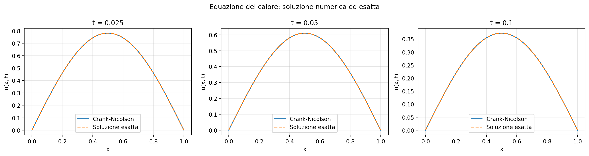
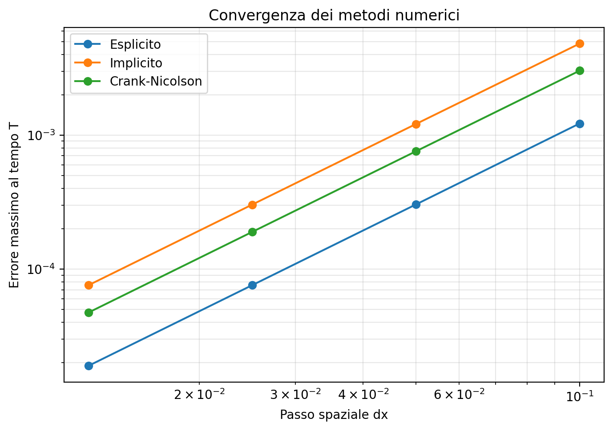

# heat-equation-solver

A Python implementation of finite-difference methods for the one-dimensional heat equation, illustrating how numerical methods approximate heat diffusion and how their accuracy depends on spatial and temporal resolution.

[](https://github.com/<USERNAME>/heat-equation-solver/actions)

This project solves the heat equation

\[
u_t = \alpha u_{xx}, \qquad 0 < x < 1,\quad t > 0,
\]

with homogeneous Dirichlet boundary conditions

\[
u(0,t)=u(1,t)=0
\]

and initial condition

\[
u(x,0)=\sin(\pi x).
\]

It compares three finite-difference methods:

- Forward Euler (explicit)
- Backward Euler (implicit)
- Crank–Nicolson (semi-implicit)

## Installation

```bash
git clone https://github.com/<USERNAME>/heat-equation-solver.git
cd heat-equation-solver
python -m pip install -e ".[dev]"
```

Replace `<USERNAME>` with your GitHub username when publishing the repository.

## Usage

Generate the figures and print the measured convergence orders:

```bash
python examples/run_demo.py
```

Run the automated tests:

```bash
python -m pytest
```

The demo saves its figures in `docs/`.

## Results

The exact solution for the chosen initial condition is

\[
u(x,t)=e^{-\alpha\pi^2t}\sin(\pi x).
\]

The following figure compares the Crank–Nicolson approximation with the exact solution at several times.



The next figure shows the maximum error at the final time against the spatial grid spacing, using logarithmic axes.



For \(\alpha=1\), final time \(T=0.1\), and spatial resolutions \(n_x=10,20,40,80\), the measured convergence orders were:

| Method | Measured order |
|---|---:|
| Forward Euler | 2.004 |
| Backward Euler | 1.998 |
| Crank–Nicolson | 2.000 |

These values were computed by the demo script. The time step was chosen approximately proportional to \((\Delta x)^2\), so the spatial and temporal errors contribute differently depending on the method.

## Stability

## Stability

For the explicit Forward Euler method, define

$$
r=\frac{\alpha\Delta t}{(\Delta x)^2}.
$$

The standard stability condition for the one-dimensional diffusion equation with this finite-difference scheme is

$$
r\leq\frac12.
$$

When this condition is violated, high-frequency numerical modes can grow exponentially instead of decaying. The following experiment uses \(\alpha=1\), \(n_x=50\), and \(T=0.1\), with the initial condition \(u(x,0)=\sin(\pi x)\).

| Target \(r\) | Effective \(r\) | Maximum absolute solution at \(T\) |
| -----------: | --------------: | ---------------------------------: |
|          0.4 |          0.4000 |              \(3.73\times10^{-1}\) |
|          0.6 |          0.5995 |              \(7.04\times10^{42}\) |

The experiment demonstrates the severe numerical growth that can occur above the stability threshold. The unstable result is still finite in floating-point arithmetic, but its magnitude makes it numerically meaningless.

The stability experiment is reproducible by running `python examples/run_demo.py`.

## What I learned

This project gave me practical experience implementing explicit and implicit finite-difference schemes for a partial differential equation. I compared the numerical solutions against an analytical solution and measured convergence orders rather than relying only on theoretical expectations. I also explored the relationship between time-step selection, spatial resolution, accuracy, and stability. Finally, I used automated tests and reproducible plotting scripts to validate and communicate the results.

## License

MIT